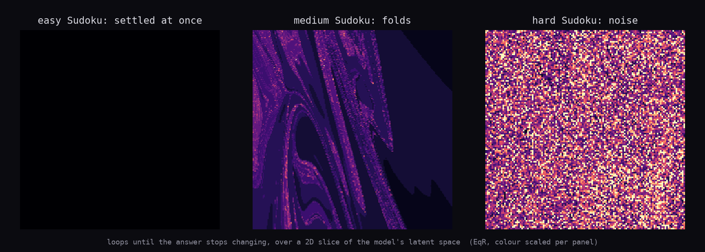
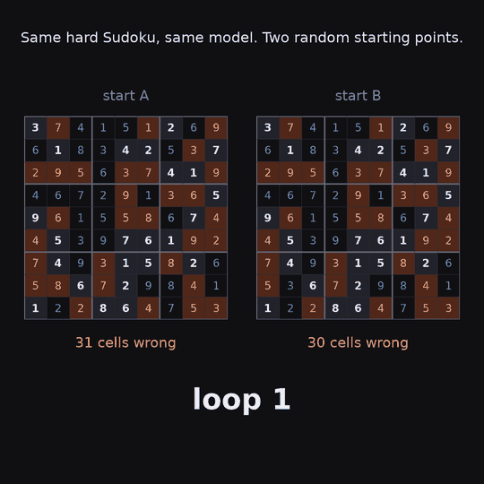
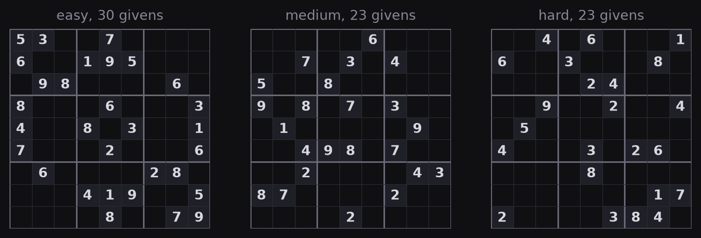

<p align="center">
  <a href="https://infraphysics.net"></a>
</p>

<p align="center">
  
</p>

<h1 align="center">fractal-basins</h1>

<p align="center">
  Reproducing <i>Fractal basins trap latent reasoning</i> (Lai, Bao, Quinn &amp; Gilpin, 2026) on the models they released.<br>
  Start a looped reasoning model from every point of a plane through its latent space and colour each point by how long it thinks.
</p>

<p align="center">
  <a href="https://arxiv.org/abs/2609.04963"></a>
  <a href="https://github.com/GilpinLab/loopscape"></a>
  
  
</p>

<p align="center">
  <b>A side project of <a href="https://infraphysics.net">InfraPhysics</a>.</b>
  The write-up is the Bits2Bricks article <a href="https://infraphysics.net/blog/bits2bricks/fractal-basins-in-looped-reasoning-models">Basin maps of a looped reasoning model, from flat to fractal</a>.
</p>

---

The models and the analysis library are the paper authors': [GilpinLab/loopscape](https://github.com/GilpinLab/loopscape)
(installed as a dependency on the GPU machine, not vendored here). This repo holds only our
experiment scripts, results and figures.

## What one run looks like

The model is applied to its own latent state again and again, and after every loop the state is
decoded into the Sudoku grid it currently believes. Below, one hard Sudoku-Extreme puzzle (rating
109) from two random starts: blue cells match the solution, orange ones do not. Start A is right
at loop 4; start B keeps about thirty cells wrong until loop 15 and is right at loop 16. The maps
above colour every start on a plane by that loop.

<p align="center">
  
</p>

The three puzzles of the maps (E1), givens only:

<p align="center">
  
</p>

`exp/sudoku_figures.py` draws both from the E6 traces (re-picking the held-out puzzles from the
Sudoku-Extreme test split as `e6_starts.py` does, checked against the stored solutions);
`exp/video.py` makes the explainer video in `social/` from one run on one GPU (`exp/v1_medium_traces.py`, `exp/v1_pick.py`, then `exp/e2_zoom.py` on that map down to 256x).

## Experiments

| | script | what |
|---|---|---|
| E1 | `exp/e1_sudoku_slices.py` | EqR basin slices on an easy, a medium and a hard Sudoku: settle time, solved fraction, basin entropy, uncertainty exponent |
| E2 | `exp/e2_zoom.py` | successive zooms into the most mixed spot of an E1 field |
| E3 | `exp/e3_linsys_training.py` | basins of the GF(3) linear-system looped transformer across a shortened (60k-step) run of loopscape's training recipe, against the released model |
| hero | `exp/hero.py` | the README strip, from the E1 fields |
| check | `exp/check_determinism.py` | same starting points in a rerun, a shuffled batch and a mixed batch give identical settle times (0/256 differ): the speckle is the model, not GPU noise |

## Results

| run | grid | loops | solved | distinct final grids | settle (min/median/max) | S_b | S_bb | alpha |
|---|---|---|---|---|---|---|---|---|
| easy | 40x40 | 24 | 100% | 1 | 0/0/0 | 0 | 0 | n/a |
| medium | 200x200 | 24 | 100% | 1 | 1/3/20 | 0.619 | 1.022 | 0.308 |
| hard | 128x128 | 48 | 88.1% | 1676 | 3/22/47 | 2.737 | 2.737 | 0.000 |

E2 zooms (EqR, same plane). Medium, 128x128, 24 loops, 4x per level: widths 0.5 / 0.125 / 0.03125 give alpha 0.263 / 0.344 / 0.185 and Sbb 1.12 / 1.11 / 1.23; the speckled bands persist down to 64x. Hard, 96x96, 48 loops, 10x per level: width 0.2 shows a smooth fast-settling island (alpha 0.008), width 0.02 a clean island edge against the noise (alpha 0.025, Sb drops 2.63 to 1.55).

E3, linear systems over GF(3), 96x96, 256 loops. Our shortened run (60k of the recipe's 300k steps, RTX A5000, 2.4 h) plateaus at 39.7% of held-out systems solved from step ~20k on (`out/e3_train_log.txt`).

| model | instance | correct | settle (median) | S_b | alpha |
|---|---|---|---|---|---|
| ours, steps 2k to 60k | hard (rng 10, 8/8 unknowns need elimination) | 0% | 3 to 23 | 0.002 to 0.53 | 0.52 to 1.01 |
| released | hard | 99.9% | 40..255 (49) | 1.81 | 0.10 |
| ours, step 60k | easy (rng 0, all by substitution) | 100% | 7 | 0 | n/a (flat) |
| released | easy | 100% | 5..7 (6) | 0.06 | 0.95 |

Fractal basins show up only where the instance is hard *and* the model solves it: a model that cannot solve it settles fast and smoothly on a wrong answer, and an easy instance needs no search. Our run never reached the second skill (elimination), so it does not show the transition itself; the full recipe would (~12 h on an A5000).

## Running

Everything runs on a rented GPU (RunPod, RTX A5000). `tools/push.sh` and `tools/pull.sh`
move files over the RunPod SSH proxy; `tools/pod.sh` runs a command there.

```bash
pip install "loopscape[demos] @ git+https://github.com/GilpinLab/loopscape"
cd exp && python e1_sudoku_slices.py 200 24 e1_medium_200.npz medium
```

## Beyond the paper (E4 to E6, RTX 3090)

| | script | result |
|---|---|---|
| E4 | `exp/e4_saddles.py` | Slow starts on the medium Sudoku spend their extra loops about 25 cells from the solution while the latent state keeps moving ~0.3 RMS per loop, then are captured in one or two loops; no stretch spent one or two cells off. On 30 hard Sudokus, slow starts wander ~30 cells away. |
| GPU | (E4 vs E1) | Same starts on A5000 (E1) and 3090 (E4): smooth region 128/128 identical settle times; speckle 2/88 identical, correlation -0.18. Deterministic on one card, not across cards. |
| E5 | `exp/e5_difficulty.py` | 36 Sudoku-Extreme puzzles across tdoku-backtrack bands, 32x32 maps: Spearman rho 0.27 (p 0.12) between rating and mean settle time. The six puzzles where the model gets lost are rated 11 to 162; the four hardest (271 to 290) settle in 1 to 7 loops. |
| E6 | `exp/e6_starts.py`, `exp/e6_policies.py` | 30 held-out hard puzzles x 64 random starts x 64 loops: 95% settle (3 loops unchanged, decided online), 100% of settled answers right. Restart at loop 20 reaches 97.8% at 128 loops vs 96% for one start; CMA-ES start (32-dim subspace, 4 train puzzles) + restarts 99.5%, but no faster than a median random start on held-out puzzles. |
